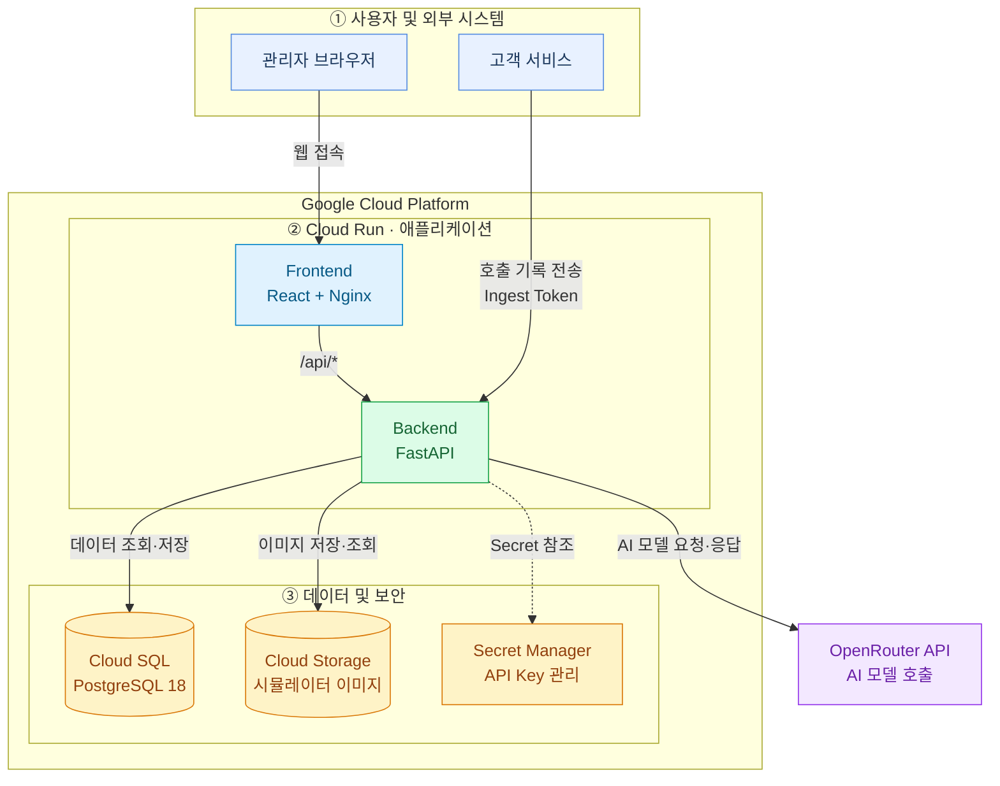

# BASE Patron

로그베이스가 고객에게 제공하는 AI 서비스와 사내 AI 사용의 **원가를 한곳에서 보고, 새 AI 모델을 안전하게 비교·검증하는 관리자(Super Admin) 콘솔**의 서비스

## 왜 만들었나

로그베이스는 AI PDP를 비롯한 AI 서비스를 여러 고객에게 제공합니다. 고객이 서비스를 쓸 때마다 AI 모델이 호출되고, 호출 수와 토큰 수만큼 비용이 생깁니다.  
이 비용을 다루면서 세 가지가 어려웠습니다.

- **고객별로 발생한 비용의 상세정보를 알기 어렵다.** 어떤 고객이 어떤 서비스를 얼마나 썼고, 그 때문에 API 비용이 얼마 나왔는지 따로 모아 보기 어렵습니다.
- **내부 비용이 고객 비용과 섞인다.** 개발·테스트·모델 비교에 쓴 비용과 월 구독료가 고객 사용분과 섞이면 고객별 원가와 내부 예산이 모두 틀어집니다.
- **새 모델을 바꿔 보기 어렵다.** 새 모델이 나올 때마다 개발자가 모델 ID와 가격을 코드에 넣고, 같은 입력으로 품질·속도·비용을 직접 비교해야 합니다.

Patron은 이 세 가지를 화면 다섯 개와 기록 API 하나로 해결합니다.

## 주요 기능

| 화면 | 하는 일 |
|---|---|
| **P-01 고객 AI 사용 현황** | 고객·서비스·모델·기간별 작업 건수, API 호출 수, 확정·추정 비용, 월 예산 대비 사용률을 봅니다.   요약 카드, 일별 추이, 고객별 표, 호출 단위 상세 내역을 같은 조건으로 함께 보여 줍니다. |
| **P-02 내부 AI 예산 관리** | 사내 프로젝트의 API 비용, 월 구독료, 구성원별 Command Code 크레딧 사용량을 함께 관리합니다. 프로젝트를 알 수 없는 사용은 '미분류'로 따로 보여 줍니다. |
| **P-03 AI 모델 관리** | OpenRouter의 모델을 검색해 등록하고, 실제 호출로 연결을 테스트하고, 서버 업체별 단가 이력을 확인합니다. |
| **P-04 AI 모델 시뮬레이터** | 같은 프롬프트(이미지 포함)를 모델 2~4개에 동시에 보내 응답, JSON·Schema 검증 결과, 지연 시간, 토큰, 비용을 나란히 비교합니다. |
| **P-05 시뮬레이션 결과 이력** | 지난 비교 실행과 결과를 다시 보고, 지난 조건을 시뮬레이터로 불러와 새 실행으로 다시 돌립니다. |

화면 밖 기능:
- **호출 기록 API** (`POST /api/usage-records`): 고객 서비스가 OpenRouter 호출을 마칠 때마다 결과를 한 건씩 보냅니다. Patron은 호출 경로 중간에 끼지 않으므로 Patron이 멈춰도 고객 서비스는 영향받지 않습니다. 규격: [docs/USAGE-RECORDS.md](docs/USAGE-RECORDS.md)
- **가격 동기화와 새 모델 점검** (CLI): 사용 중인 모델의 단가가 바뀌면 새 가격 행으로 남기고, 새로 올라온 모델을 기본 모델과 같은 시나리오로 비교합니다.
- **AI 도우미**: 업무 화면 오른쪽 아래 버튼으로 열어, 사용량·비용·모델·시뮬레이션 이력을 대화로 조회하고 시뮬레이터 설정을 준비합니다. 개발 환경에서는 OpenRouter 모델로 켜 두었고, 시뮬레이터와 Key를 함께 쓰므로 하루(KST) 비용 한도를 따로 둡니다. 로컬에서는 Ollama 모델로도 실행할 수 있습니다(설정을 켜야 동작). [docs/ASSISTANT.md](docs/ASSISTANT.md)

## 설계 원칙

비용 관리 도구라서 **숫자를 믿을 수 있는지**를 가장 중요하게 다뤘습니다.

- **모르는 비용을 0으로 적지 않습니다.** 비용을 알 수 없으면 `UNKNOWN`으로 두고 화면에도 '미확인'으로 표시합니다. 지출을 실제보다 작게 보고하지 않기 위해서입니다.
- **확정·추정·미확인을 나눕니다.** OpenRouter가 알려 준 비용은 확정, 단가로 계산한 비용은 추정입니다. 과거 확정 비용을 현재 가격으로 다시 계산하지 않습니다.
- **고객 비용과 내부 비용을 섞지 않습니다.** 모든 호출에 출처(고객 서비스, 내부 개발, 시뮬레이션, 연결 테스트, AI 도우미)를 기록합니다. 고객이나 프로젝트를 알 수 없는 호출은 아무 곳에나 붙이지 않고 미분류로 둡니다.
- **이력을 지우거나 덮어쓰지 않습니다.** 호출 기록, 시뮬레이션 결과, 모델 가격, 업로드 이미지는 추가만 합니다. 재실행은 새 ID로, 가격 변경은 새 행으로 남깁니다.
- **금액은 `Decimal`로 계산합니다.** OpenRouter 단가는 토큰당 소수 10자리까지 나오므로 float 대신 `NUMERIC(30,18)`로 저장하고, API에서는 문자열로 주고받습니다.
- **로그인 없이 열리는 API를 최소로 둡니다.** 로그인과 health를 뺀 모든 `/api`는 로그인 세션을 요구하고, 고객 서비스가 쓰는 기록 API는 전용 Ingest 토큰을 요구합니다. 모든 라우트를 훑어 이 목록과 다르면 실패하는 테스트로 지킵니다.
- **비밀값은 코드와 DB에 넣지 않습니다.** OpenRouter Key와 기록 API 토큰은 환경변수나 Secret Manager로만 받습니다. DB에는 Key 원문 대신 환경변수 이름만 둡니다.
- **합산은 서버 한 곳에서만 합니다.** 같은 조건이면 요약 합계와 상세 합계가 같도록, 화면에서 다시 더하지 않습니다.

## 아키텍처


- 브라우저는 `/api`만 호출하고, nginx가 이를 backend로 넘깁니다.
- 백엔드는 `api`(입출력) → `services`(규칙·계산) → `models.py`(ORM) 순서로만 의존합니다. OpenRouter 호출은 `app/openrouter/client.py` 한 곳에서만 합니다.
- **API 계약은 한 곳에서만 정의합니다.** 백엔드 Pydantic 모델에서 OpenAPI 문서를 만들고, 프론트엔드는 그 문서에서 TypeScript 타입을 생성해 씁니다. 상태 값과 오류 코드도 백엔드 enum 하나에서 나옵니다.
- 시각은 UTC로 저장하고, 월 경계 집계는 서버에서 KST 기준으로 합니다.

자세한 구조와 데이터 흐름은 [docs/ARCHITECTURE.md](docs/ARCHITECTURE.md)를 보세요.

## 기술 스택

| 영역 | 사용 기술 |
|---|---|
| 백엔드 | Python 3.14, FastAPI, Pydantic v2, SQLAlchemy 2 (async), Alembic, httpx, uv, Ruff, pytest |
| 프론트엔드 | React 19 (React Compiler), TypeScript, Vite, TanStack Router·Query, React Hook Form, Zod 4, Tailwind CSS v4, Recharts, pnpm, Biome, Vitest |
| 데이터 | PostgreSQL 18 |
| AI | OpenRouter API (여러 회사의 모델을 한 API로 호출) |
| 인프라 | Docker, GCP Cloud Run · Cloud SQL · Cloud Storage · Artifact Registry · Secret Manager · Cloud Build, GitHub Actions |
| 디자인 | 토스 디자인 시스템(TDS)을 참고해 데스크톱 대시보드용 디자인 시스템을 직접 구성 ([docs/design/](docs/design/)) |

## 폴더 구조

```text
backend/            FastAPI 서버
  app/api/          라우터 (입력 검증, 인증, 응답 변환)
  app/services/     비즈니스 규칙, 집계, 비용 계산
  app/schemas/      API 요청·응답 모델 (API 계약의 정본)
  app/openrouter/   OpenRouter 클라이언트
  migrations/       Alembic 마이그레이션
  tests/            실제 PostgreSQL로 도는 테스트
frontend/           React SPA
  src/features/     화면별 기능 (customer-usage, internal-budget, models, simulator, simulation-history)
  src/shared/       공용 UI 컴포넌트, 생성된 API 타입, KST·금액 포맷
docs/               아키텍처, 연동 규격, 디자인 기준
cloudbuild.yml      배포 파이프라인
docker-compose.yml  로컬 DB와 전체 실행 구성
```

## 로컬에서 실행하기

준비물: Docker, [uv](https://docs.astral.sh/uv/), Node.js 24 이상, pnpm

```bash
# 1. 환경변수 파일을 만들고 값을 채웁니다 (필요한 변수 이름은 .env.example에 있습니다)
cp .env.example .env

# 2. PostgreSQL을 띄웁니다
docker compose up -d db

# 3. 백엔드: 의존성 설치, 마이그레이션, 예시 데이터, 관리자 계정
uv --directory backend sync
uv --directory backend run alembic upgrade head
uv --directory backend run python -m app.cli seed
uv --directory backend run python -m app.cli user-create --email admin@example.com --name 관리자 --user-code ADMIN-001
uv --directory backend run fastapi dev app/main.py

# 4. 프론트엔드 (다른 터미널에서)
pnpm --dir frontend install
pnpm --dir frontend dev
```

브라우저에서 http://localhost:5173 에 접속해 만든 계정으로 로그인합니다.

- `seed`는 개발 DB에만 예시 고객·사용 데이터를 넣습니다. 실제 OpenRouter는 호출하지 않습니다. 개발 환경의 P-01·P-02 숫자도 이 예시 데이터이며 실제 고객 데이터가 아닙니다.
- `OPENROUTER_API_KEY`가 없어도 앱은 뜹니다. 시뮬레이션과 연결 테스트 요청만 거절됩니다.
- 컨테이너로 한 번에 띄우려면 `docker compose --profile full up`을 씁니다.

## 테스트와 검사

PR마다 GitHub Actions가 아래 명령을 똑같이 실행합니다. 모두 저장소 루트에서 실행합니다.

```bash
uv --directory backend run ruff check
uv --directory backend run ruff format --check
uv --directory backend run pytest -q        # docker compose up -d db 필요
pnpm --dir frontend typecheck
pnpm --dir frontend lint
pnpm --dir frontend test
pnpm --dir frontend build
```

- 테스트는 실제 OpenRouter를 부르지 않고 가짜 클라이언트를 씁니다.
- 팀 규칙으로 테스트를 먼저 쓰는 방식(TDD)을 따릅니다. 테스트는 특히 로그인 실패 응답이 계정 존재 여부를 드러내지 않는지, 요약 합계와 상세 합계가 같은지, KST 월 경계와 모델 2~4개 같은 경계값의 바로 전·그 값·바로 후를 검증합니다.

## 배포

`dev` 브랜치에 병합되면 Cloud Build가 [cloudbuild.yml](cloudbuild.yml)로 다음 순서를 실행합니다.

1. 이미지 두 개(frontend, backend)를 빌드해 Artifact Registry에 올립니다.
2. Cloud Run Job으로 DB 마이그레이션을 실행합니다.
3. backend와 frontend를 Cloud Run에 배포합니다.

마이그레이션이 실패하면 배포도 멈춥니다. 비밀값은 Secret Manager에서 버전을 고정해 읽습니다. 배포는 `dev` 브랜치 기준으로만 하고, `main`은 배포하지 않습니다.

## 문서

| 문서 | 내용 |
|---|---|
| [docs/ARCHITECTURE.md](docs/ARCHITECTURE.md) | 폴더 구조와 데이터 흐름 |
| [docs/USAGE-RECORDS.md](docs/USAGE-RECORDS.md) | 고객 서비스 → Patron 호출 기록 연동 규격 |
| [docs/ASSISTANT.md](docs/ASSISTANT.md) | AI 도우미 로컬(Ollama) 실행 방법 |
| [docs/design/](docs/design/) | 디자인 토큰, 화면 원칙, 화면별 결정 |
| [CONTRIBUTING.md](CONTRIBUTING.md) | 브랜치·PR·테스트 배치 규칙 |
